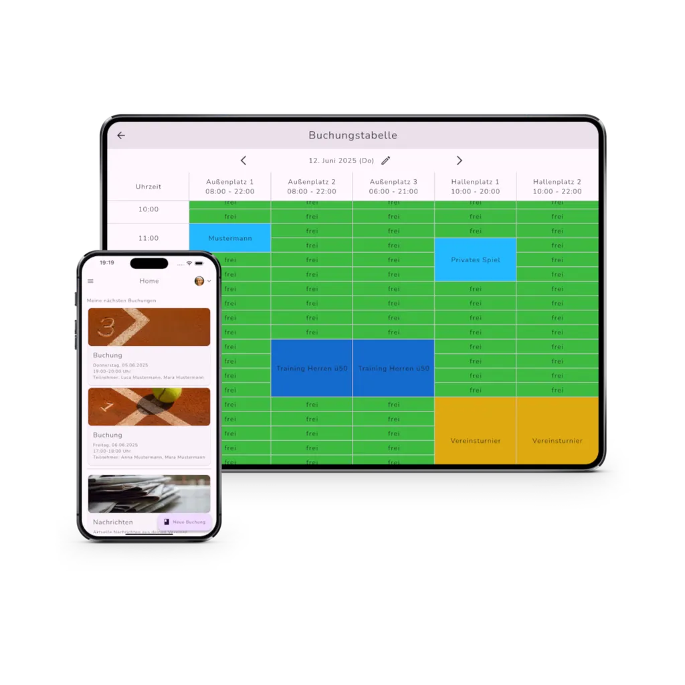

# tennify

### Website und App im Team weiterentwickeln

Eine Arbeitsprobe von **Cem Bagana** zu App-Weiterentwicklung, Fehlerbehebung in Sprints und digitalen Vereinsprozessen.

[Mein Portfolio](https://www.cembagana.de/) · [LinkedIn](https://www.linkedin.com/in/cem-bagana/) · [Produktwebsite tennify](https://tennify.de/)

## Die Ausgangslage

Bei einer Platzreservierung treffen unterschiedliche Anforderungen aufeinander: Mitglieder und Gäste, freie Zeiten und Plätze, Vereinsregeln und wiederkehrendes Training. Laut meinem dokumentierten Projektbriefing hatte die bestehende Anwendung Fehler, unter anderem bei Buchungsterminen. Gleichzeitig sollten die Website-Darstellung verbessert, die Mitgliederverwaltung angepasst und die Anwendung funktional erweitert werden.

## Mein Beitrag im Team

- **Website-Gestaltung:** den visuellen Auftritt gemeinsam überarbeitet.
- **App-Weiterentwicklung:** an Verbesserungen und funktionalen Erweiterungen mitgewirkt.
- **Bugfixes in Sprints:** bestehende Fehler schrittweise bearbeitet und im Team behoben.
- **Mitgliederverwaltung:** die Verwaltung innerhalb der Anwendung angepasst.
- **Buchungstermine:** Probleme im Buchungsbereich gemeinsam bearbeitet und gelöst.

Diese Beschreibung folgt meinem Projektbriefing, das in der Portfolio-Fallstudie mit Stand 27.09.2026 dokumentiert ist. Sie beschreibt meinen Teambeitrag; die gesamte Anwendung wird nicht als meine alleinige Entwicklung dargestellt.

## Das Produkt im Vereinsalltag

*Original-Mockup von [tennify.de](https://tennify.de/), aus dem Bildbestand meiner bestehenden Portfolio-Fallstudie. Es illustriert das Produkt und ist kein Vorher-nachher-Nachweis meiner einzelnen Änderungen. Marken und Produktdarstellung gehören ihren jeweiligen Rechteinhabern.*

## Ein einfacher Buchungsweg mit Regeln im Hintergrund

Der öffentliche [Buchungsleitfaden](https://tennify.de/guides/booking-guide/) beschreibt den Ablauf so:

1. Den gewünschten Spieltag auswählen.
2. Eine freie Zeit und einen Platz wählen.
3. Mitspieler oder Gäste ergänzen, sofern erforderlich.
4. Die Reservierung bestätigen.

Wiederkehrende Termine und vereinsabhängige Regeln erweitern diesen Ablauf. Diese Produktfunktionen dienen als Kontext der Arbeitsprobe und werden nicht pauschal meinem persönlichen Beitrag zugerechnet.

## Oberfläche und Daten gemeinsam betrachten

Die Portfolio-Fallstudie beschreibt außerdem eine Überarbeitung der Datenstrukturen als Grundlage für Buchungs- und Verwaltungsprozesse. Für die Produktarbeit bedeutet das: Eine verständliche Oberfläche braucht eine konsistente Zuordnung von Nutzern, Plätzen, Zeiten und Reservierungen.

| Perspektive | Anforderung |
| --- | --- |
| Mitglieder | Verfügbarkeiten erkennen und Buchungen nachvollziehen |
| Vereinsverwaltung | Mitglieder und Regeln im Zusammenhang verwalten |
| Entwicklungsteam | Fehler schrittweise beheben und Änderungen in bestehende Abläufe einfügen |

## Dokumentiertes Ergebnis

Im Team wurden laut meinem Projektbriefing bestehende Fehler behoben, die Mitgliederverwaltung angepasst und Probleme bei Buchungsterminen gelöst. Die Website-Darstellung wurde gemeinsam überarbeitet und die App funktional weiterentwickelt.

Für diese Arbeitsprobe liegen keine einzelnen Commit- oder Ticketnachweise, kein Vorher-nachher-Vergleich und keine Lasttests vor. Deshalb werden keine Fehlerquoten, Geschwindigkeitssteigerungen oder anderen gemessenen Leistungswerte angegeben.

## Was diese Arbeitsprobe zeigt

Mein Schwerpunkt liegt auf der Mitarbeit an einem bestehenden Produkt: konkrete Probleme aufnehmen, Änderungen in Sprints umsetzen und dabei Benutzeroberfläche, Daten und Vereinsabläufe zusammen betrachten.

## Quellen und Stand

- Persönlicher Beitrag: vorhandenes Projektbriefing und Portfolio-Fallstudie, dokumentierter Stand **27.09.2026**.
- Produktkontext: [tennify](https://tennify.de/) und [Buchungsleitfaden](https://tennify.de/guides/booking-guide/), Leitfaden am **20.10.2026** abgerufen. Die Produktdokumentation bestätigt den beschriebenen Ablauf, nicht meinen persönlichen Projektbeitrag.
- Veröffentlichung dieser Arbeitsprobe: **20.10.2026**. Enthalten sind die Fallstudie und ein Original-Produktmockup; kein interner Anwendungsquellcode.

Weitere Arbeitsproben: [FA Finance](https://github.com/cembagana62-jpg/fa-finance-case-study) · [Kamm In](https://github.com/cembagana62-jpg/kamm-in-case-study) · [All Villa](https://github.com/cembagana62-jpg/all-villa-case-study)
